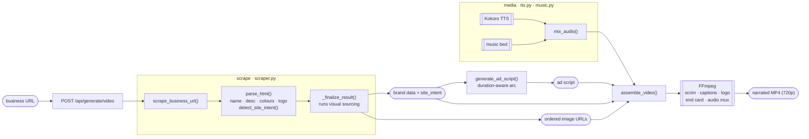
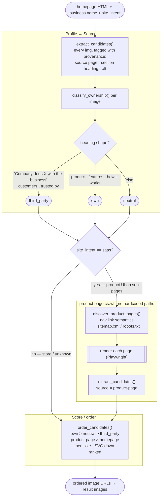
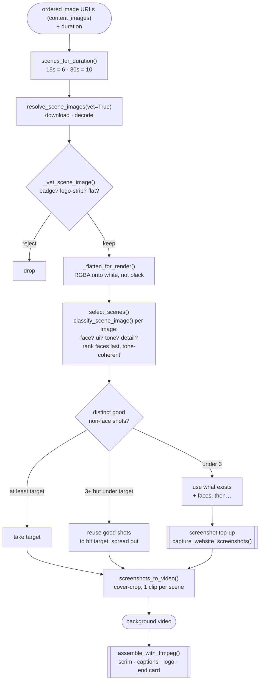

# AdCraft — generation pipeline architecture

How a business URL becomes a narrated MP4, and specifically how the ad's
**scenes** are sourced and chosen. Diagrams are Mermaid (render in GitHub and in
VS Code's preview). Prose lives in [`AGENTS.md`](./AGENTS.md); this file is the
map.

**One idea runs through the whole thing:** the hard problem is *which visuals*
an ad should use, and it is split into two stages that each use only the data
they have —

- a **text / structure** stage (`visual_sourcing.py`, at scrape time) decides
  which image URLs are worth using and in what order, from page structure,
  section headings and the sitemap;
- a **pixel** stage (`video_assembler.py`, at render time) downloads them and
  makes the calls that need actual pixels — face vs UI, flat vs busy, coherent
  tone.

Because the pixel stage runs after and filters, the text stage never has to be
perfect.

```
Shape key:  ([ ... ])  data / artifact      [ ... ]  step / function
            { ... }    decision             [[ ... ]] external process
```

---

## 1. End-to-end



`/generate/rerender` skips `scrape` + `generate_ad_script` and re-enters at
`assemble_video` with the editor's edited copy.

---

## 2. Visual sourcing — the text / structure stage

`services/visual_sourcing.py`, called once from `_finalize_result`. Produces the
ordered candidate image URLs. **Nothing here is per-site**: discovery is the
site's own sitemap + nav, ownership is the site's own section headings.



**Why ownership generalises:** a customer/case-study section reads
*"{external company} {verb} with {business}"* — "Hertz unifies commerce with
Stripe". That shape is detectable without any list of brand names, and it is
what flagged 18/35 of Stripe's homepage images as third-party so its *own*
product UI could lead.

---

## 3. Scene selection — the pixel / assembly stage

Inside `assemble_video()` (`video_assembler.py`). Takes the ordered URLs and
turns them into the background video. This is where the calls that need pixels
happen, and where the ordered-but-imperfect list gets cleaned.



**The safety-net relationship:** stage 2 orders by text signals and can leave
junk near the front (a `close.svg`, a social card); stage 3's `vet` + `classify`
reject or sink it. Neither stage carries the whole burden.

---

## Where each concern lives

| Concern | Stage | Function(s) |
|---|---|---|
| Site type | scrape | `detect_site_intent` |
| Find product pages | scrape | `discover_product_pages` (sitemap + nav) |
| Own vs customer imagery | scrape | `classify_ownership` (section headings) |
| Candidate ordering | scrape | `order_candidates` |
| Badge / logo-strip / flat rejection | assembly | `_vet_scene_image` |
| Face vs UI vs photo, tone | assembly | `classify_scene_image` |
| Final pick + coherence + reuse | assembly | `select_scenes` + fill logic |
| Scene count by length | assembly | `scenes_for_duration` |
| Script length / arc by length | script | `build_prompt` (duration branch) |
